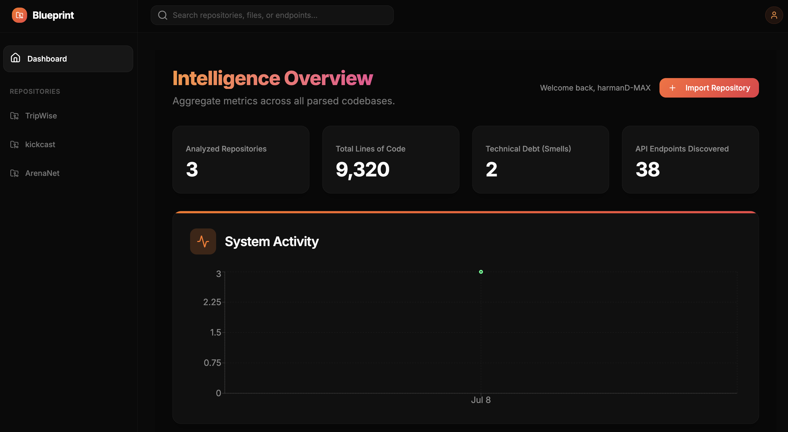
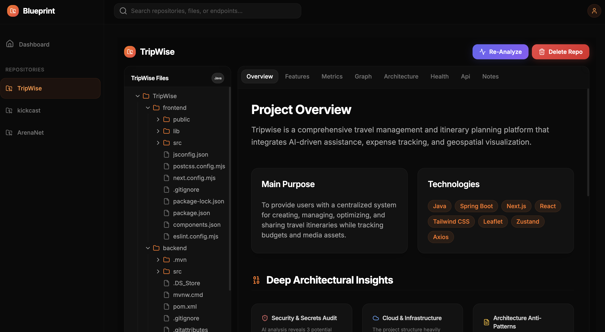
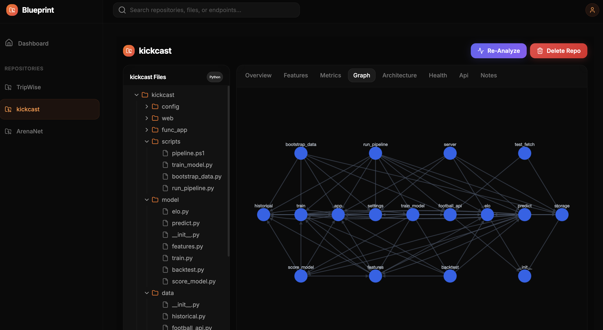
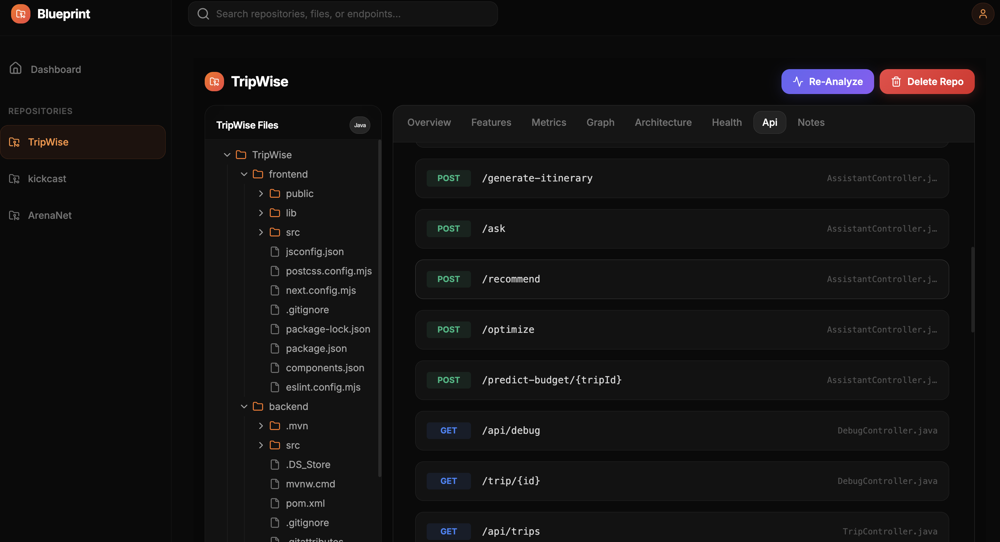
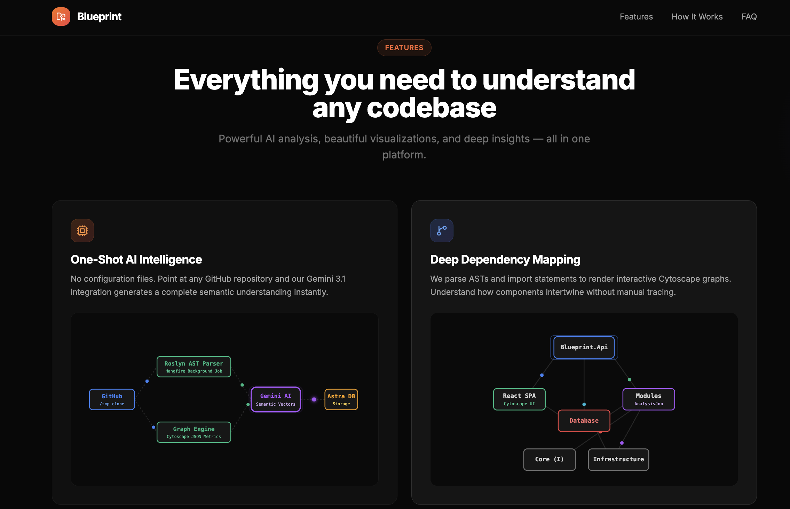

# Blueprint

Blueprint is a full-stack web application that lets you point at any GitHub repository and instantly get a complete architectural breakdown. It clones your repo, parses the codebase, runs it through Google's Gemini AI, and presents you with interactive dependency graphs, technical debt audits, AI-generated documentation, and feature descriptions.

## Preview







## Features

### Core Intelligence
- **One-Shot AI Analysis**: Paste a GitHub URL and get an architectural breakdown powered by Google Gemini. No config files, no setup.
- **Interactive Dependency Graphs**: Visualize how your classes, services, and controllers connect using Cytoscape.js. The backend extracts these dependencies via file analysis and string matching.
- **Technical Debt Auditing**: Identifies large files (over 500 lines) and unresolved TODO/FIXME comments across your codebase.
- **Repository Search**: Search through all analyzed repositories in your Astra DB instance by name or content match.

### Developer Tools
- **Live Code Viewer**: Browse any file in the repo with syntax highlighting directly in the browser using Monaco Editor.
- **API Endpoint Discovery**: Auto-scans routers, controllers, and handlers to discover REST endpoints. Supports ASP.NET Core, Minimal APIs, Spring Boot, Express, Flask, and FastAPI.
- **Features & Resume Builder**: AI generates a detailed breakdown of every feature in the repo, explains how it's built internally, lists the technologies used, and writes ATS-optimized summary points.

### Platform
- **GitHub OAuth Login**: Secure authentication via GitHub OAuth. Your session persists across browser refreshes using Redux and localStorage.
- **Real-Time Progress**: Live analysis progress updates via SignalR WebSocket connections during the repository import process.
- **Background Job Processing**: Heavy analysis runs asynchronously via Hangfire (InMemory storage) so the UI remains responsive.

## Tech Stack

### Frontend
- **React 19** with TypeScript
- **Vite** for local development and building
- **TailwindCSS** for UI styling
- **Redux Toolkit** for state management
- **React Router v7** for routing
- **Cytoscape.js** for graph rendering
- **Monaco Editor** for viewing code
- **Recharts** for dashboard analytics
- **Lucide React** for UI icons
- **SignalR Client** for real-time WebSocket updates

### Backend
- **.NET 10 (C#)** for the RESTful API
- **Astra DB** (DataStax Cassandra JSON API) for storing repository metadata, file trees, and AI insights. SQLite is intentionally not used.
- **Hangfire (InMemory)** for background job processing
- **SignalR** for real-time WebSocket hubs
- **Google Gemini AI** for code analysis
- **JWT Authentication** for securing endpoints post-GitHub OAuth
- **LibGit2Sharp** for cloning repositories locally

## Installation

### Prerequisites
- Node.js 18+ and npm
- .NET 10 SDK
- Git
- A GitHub OAuth App (for login)
- A Google Gemini API Key
- An Astra DB instance and Application Token

### 1. Clone the Repository
```bash
git clone https://github.com/your-username/Blueprint.git
cd Blueprint
```

### 2. Backend Setup
```bash
cd backend

# Restore dependencies
dotnet restore

# Set your environment variables (or update appsettings.json)
export GEMINI_API_KEY="your-gemini-api-key"
export GITHUB_CLIENT_ID="your-github-oauth-client-id"
export GITHUB_CLIENT_SECRET="your-github-oauth-client-secret"
export Astra__Token="your-astra-db-token"
export Astra__Endpoint="your-astra-db-endpoint"
export Astra__Keyspace="your-keyspace-name"
export Astra__Collection="your-collection-name"

# Run the backend
dotnet run --project Blueprint.Api/Blueprint.Api.csproj
```
The API will start on http://localhost:5243.

### 3. Frontend Setup
```bash
cd frontend

# Install dependencies
npm install

# Start the dev server
npm run dev
```
The frontend will start on http://localhost:5173.

### 4. Open in Browser
Navigate to http://localhost:5173, click Get Started, and sign in with your GitHub account. Import any public repository URL and watch Blueprint analyze it.
